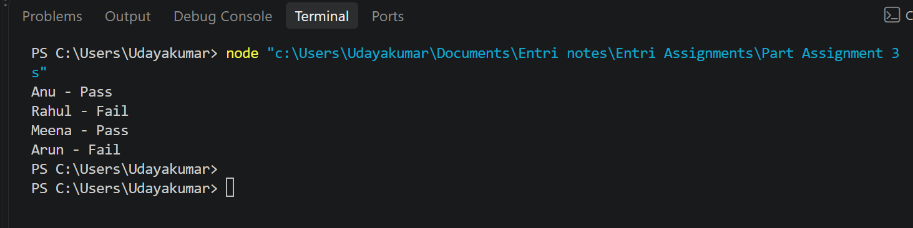
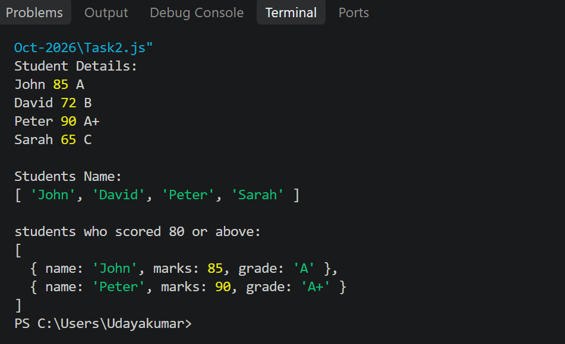
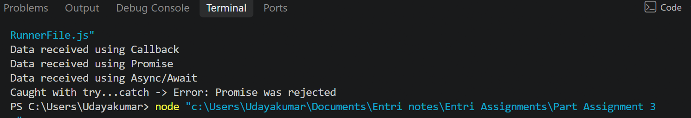

# JavaScript Practical Assignment
Covers functions, arrow functions, control flow, arrays, array methods and asynchronous JavaScript.

# Project Structure

js-assignment/
	01.Task1.js		# Functions, Arrow Functions & Control Flow
	02.Task2.js		# Arrays & Array Methods
	03.Task3.js		# Asynchronous JavaScript (theory + small demo)
screenshots/
	01.Task1_output.png
	02.Task2_output.png
	03.Task3_output.png
README.md

# Program Descriptions

# Task1 – Functions, Arrow Functions & Control Flow ('Task1.js')
- 'calculateResult(marks)' – regular function; returns '"Pass"' if marks ≥ 50, else '"Fail"'.
- 'displayResult(name, result)' – arrow function; prints 'Name - Result'.
- Learner data stored in an array of objects.
- A 'for...of' loop processes each learner, gets the result and displays it.

# Task2 – Arrays & Array Methods ('Task2.js')
- 'forEach()' – prints every student as 'Name - Marks - Grade'.
- 'map()' – creates a new array of student names.
- 'filter()' – creates a new array of students with marks ≥ 80.

# Task3 – Asynchronous JavaScript ('Task3.js')
- Theory answer written as comments at the top of the file:
  - What asynchronous JavaScript is
  - Callbacks and how they are used
  - Promises and their three states (Pending, Fulfilled, Rejected)
  - Async/Await and how it handles Promises
  - Advantage of Async/Await over callbacks
- A short runnable demo shows a callback, a promise (fulfilled and rejected) and async/await with 'try...catch'.

# Execution Steps

1. Install [Node.js](https://nodejs.org/) (v14 or later).
2. Clone the repository:
   ---bash
   git clone <your-repo-url>
   cd js-assignment
 ---
3. Run each task:
  ---bash
   node Task1.js
   node Task2.js
   node Task3.js
-----

# Expected Output

**Task 1**
----
Anu - Pass
Rahul - Fail
Meena - Pass
Arun - Fail
-----

**Task 2**
-----
All Students:
John - 85 - A
David - 72 - B
Peter - 90 - A+
Sarah - 65 - C

Student Names:
[ 'John', 'David', 'Peter', 'Sarah' ]

Students who scored 80 or above:
[
  { name: 'John', marks: 85, grade: 'A' },
  { name: 'Peter', marks: 90, grade: 'A+' }
]
-----

**Task 3 (demo)**
----
Data received using Callback
Data received using Promise
Data received using Async/Await
Caught with try...catch -> Error: Promise was rejected
----

# Screenshots Reference

| Task | Screenshot |
|------|------------|
| Task 1 |  |
| Task 2 |  |
| Task 3 |  |
